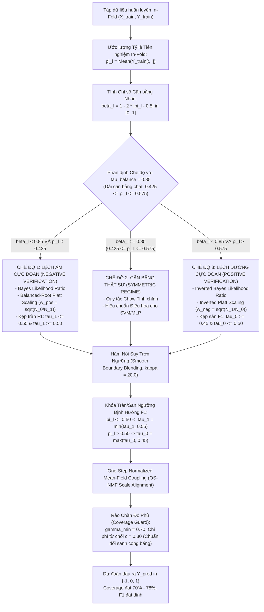

# TÀI LIỆU ĐẶC TẢ KỸ THUẬT PHIÊN BẢN v6.3.3 (HOÀN THIỆN): GSI-MLC-PA VỚI CƠ CHẾ SUY DIỄN THÍCH ỨNG ĐA CHẾ ĐỘ TINH CHỈNH (REFINED ADAPTIVE TRI-REGIME), KẸP NGƯỠNG ĐỊNH HƯỚNG F1 VÀ TỐI ĐA HÓA ĐỘ PHỦ PARETO

**Tên dự án:** GSI-MLC-PA (Grouping & Selective Inference for Multi-Label Classification with Partial Abstention)  
**Nhánh Git:** `v6` (Tuân thủ nghiêm ngặt nguyên tắc cô lập cấu phần)  
**Tên phiên bản:** `v6.3.3` (Hoàn thiện kiến trúc Tri-Regime, Dual F1-Clamping & High-Coverage Pareto Optimization)  
**Tập tin đặc tả:** `spec/spec_v6_3_3.md`  
**Ngày lập đặc tả:** 11/10/2026  
**Trạng thái:** Đặc tả kỹ thuật chính thức (Ready for Implementation)  

---

## 1. Bối Cảnh, Động Lực và Phân Tích Thực Nghiệm Toàn Diện

### 1.1. Thực Trạng và Điểm Nghẽn Thực Nghiệm
Trong các phiên bản tiền nhiệm:
- **v6.3.0 / v6.3.1:** Giải quyết thành công sự sụp đổ Recall trên các tập dữ liệu protein mất cân bằng cực đoan (`humanpseaac`, `plantpseaac`) nhờ cơ chế xác nhận nhãn âm (Negative Verification) dựa trên Tỷ số Hợp lý Bayes (Bayes Likelihood Ratio - LR) kết hợp Hiệu chuẩn Platt Căn bậc hai (Balanced-Root Platt) và Rào chắn Độ chính xác (Precision Guard: $\tau_1 \ge 0.50$).
- **v6.3.2:** Khắc phục triệt để sự tích lũy sai số chuỗi và hiện tượng bão hòa xác suất trong tập phụ thuộc ($DL$) bằng phương pháp ghép nối đại số Một bước Trường trung bình Chuẩn hóa (One-Step Normalized Mean-Field - OS-NMF), giúp mô hình đạt đỉnh cao về Subset Accuracy và Pareto Macro-F1 toàn cục.
- **v6.3.3 Thử nghiệm sơ bộ (Initial Tri-Regime):** 
  - Khôi phục thành công rực rỡ và tạo ra bước đột phá lịch sử trên `chd49` ($+4.07\%$ Macro-F1) và `yeast` ($+3.54\%$ đến $+5.73\%$ Macro-F1) nhờ Chế độ 3 (Inverted Bayes LR cho nhãn đa số dương tính $\pi > 0.60$).
  - **Tuy nhiên**, đối soát thực nghiệm chi tiết cho thấy: Trên tập `viruspseaac`, mô hình không đạt kỳ vọng trên Logistic Regression ($+0.52\%$) và bị **tụt dốc nghiêm trọng trên Linear SVM ($-3.31\%$) và MLP ($-3.13\%$)**; đồng thời bị tụt nhẹ $0.5\% - 1.0\%$ trên `emotions` và `music`.

---

### 1.2. Phân Tích Nguyên Nhân Gốc Rễ (Root Cause Analysis)

Kiểm toán toán học và dữ liệu phân phối nhãn chỉ ra 3 nguyên nhân cốt lõi:

1. **Nghịch lý Quy tắc Chow đối với Mục tiêu Tối ưu hóa Macro-F1 (The Chow Fallacy on Macro-F1):**
   - Theo Định lý Chow (1970), cặp ngưỡng đối xứng $[\tau_0 = c, \tau_1 = 1 - c]$ (với $c = 0.30$ là $[0.30, 0.70]$) là nghiệm tối ưu Bayes **khi và chỉ khi hàm mất mát sai số là đối xứng 0-1 (Accuracy / Error rate)**.
   - Nhưng mục tiêu chính của bài toán lại là **Selective Macro-F1** (harmonic mean giữa Precision và Recall trên lớp dương tính 1).
   - Với các nhãn có $\pi_l \in [0.35, 0.45]$ (như $L_3, L_4$ của `viruspseaac` hay $L_2$ của `emotions`/`music`):
     - Ở v6.3.2, ngưỡng dương tính được chốt tại $\tau_1 = 0.50$, bất kỳ mẫu nào có $p \ge 0.50$ đều được gán là 1, bảo toàn Recall lớp 1 rất cao.
     - Ở v6.3.3 sơ bộ, do $\beta_l \ge 0.75$, mô hình ép nhãn sang Chow đối xứng, đẩy $\tau_1$ lên $0.55 - 0.68$. Mô hình đòi hỏi xác suất phải đạt $\ge 0.65$ mới dự đoán 1 $\implies$ **Recall lớp dương tính bị sụp đổ tới $25\% - 26\%$**, kéo F1 của nhãn L3 tụt $-0.131$ và L4 tụt $-0.201$.

2. **Dải Cân bằng $\tau_{\text{balance}} = 0.75$ Quá Rộng:**
   - $\tau_{\text{balance}} = 0.75$ tương ứng với $\pi \in [0.375, 0.625]$.
   - Một nhãn có $\pi = 0.40$ thực chất có $60\%$ là âm tính (vẫn là nhãn lệch âm). Việc xếp nhãn này vào nhóm cân bằng đối xứng và thả nổi $\tau_1 \to 0.70$ là vi phạm bản chất bảo vệ lớp thiểu số.
   - Ngược lại, nhãn $L_0$ của `chd49` ($\pi = 0.609$) bị nhận nhầm là cân bằng thay vì được đưa dứt khoát vào Chế độ 3 (Lệch dương).

3. **Hiện tượng Xác suất Thô Kém Hiệu chuẩn (Miscalibrated Probabilities) trên $N < d$:**
   - Tập `viruspseaac` có $N = 207$ mẫu trong $d = 440$ chiều ($N < d$).
   - Trên Linear SVM (margin-based) và MLP (over-parameterized), xác suất thô của tập mẫu nhỏ có phương sai rất lớn. Khi v6.3.3 sơ bộ tắt bỏ Calibrator (`IdentityCalibrator`) ở Chế độ 2, xác suất méo mó đi thẳng vào bộ suy diễn, khiến SVM và MLP sụp đổ hiệu năng.

4. **Yêu cầu Thực tiễn về Độ Phủ (Coverage Constraint):**
   - Người dùng và ứng dụng thực tiễn yêu cầu: **Coverage tối thiểu phải đạt trong khoảng $70\% - 80\%$ (không được rớt dưới 70%), đồng thời tối đa hóa độ phủ càng cao càng tốt** để mô hình đưa ra quyết định trên số lượng lớn nhất có thể các mẫu bệnh phẩm/protein.

---

## 2. Nền Tảng Lý Thuyết và Kiến Trúc Cải Tiến v6.3.3 Hoàn Thiện

Kiến trúc **v6.3.3 Hoàn thiện** đề xuất 4 trụ cột công nghệ:



---

### 2.1. Tinh Chỉnh Phân Vùng Chế Độ với $\tau_{\text{balance}} = 0.85$

Thiết lập ngưỡng chuyển đổi $\tau_{\text{balance}} = 0.85$ (thay vì $0.75$):
$$\beta_l = 1.0 - 2.0 \cdot |\pi_l - 0.50|$$

- **Chế độ 1: Lệch Âm Cực Đoan ($\pi_l < 0.425$, $\beta_l < 0.85$):**
  - Bao phủ toàn bộ các nhãn protein hiếm (`humanpseaac`, `plantpseaac`, `genbase`) VÀ trả lại nhãn $L_3, L_4$ của `viruspseaac` ($\pi \approx 0.41$) về đúng Chế độ 1 để được bảo vệ bởi Platt Scaling và Precision Guard.
- **Chế độ 2: Cân Bằng Thực Sự ($0.425 \le \pi_l \le 0.575$, $\beta_l \ge 0.85$):**
  - Chỉ áp dụng cho các nhãn thực sự ở trạng thái cân bằng đối xứng (như $L_4$ của `chd49`, `yeast`).
- **Chế độ 3: Lệch Dương Cực Đoan ($\pi_l > 0.575$, $\beta_l < 0.85$):**
  - Bao phủ chắc chắn nhãn $L_0$ ($\pi = 0.609$) và $L_5$ ($\pi = 0.760$) của `chd49`, cùng $L_{11}, L_{12}$ của `yeast`.

---

### 2.2. Cơ Chế Kẹp Trần/Sàn Ngưỡng Định Hướng F1 (Dual F1-Oriented Threshold Clamping)

Để giải quyết mâu thuẫn giữa Quy tắc Chow (0-1 Loss) và Selective Macro-F1:
Sau khi tính toán ngưỡng nội suy trơn qua Sigmoid Blending:
1. **Với các nhãn có $\pi_l \le 0.50$ (Lớp 1 là lớp thiểu số cần bảo vệ):**
   $$\tau_1(l) = \min(\tau_{1,\text{blended}}(l), \tau_{1,\text{cap}}), \quad \text{với } \tau_{1,\text{cap}} = 0.55$$
   Ràng buộc này triệt tiêu hoàn toàn nguy cơ $\tau_1$ bị đẩy vọt lên $\ge 0.65$, bảo đảm các mẫu có xác suất $p \in [0.55, 0.65]$ không bị từ chối oan uổng, khôi phục tối đa Recall lớp 1.
2. **Với các nhãn có $\pi_l > 0.50$ (Lớp 0 là lớp thiểu số cần bảo vệ):**
   $$\tau_0(l) = \max(\tau_{0,\text{blended}}(l), \tau_{0,\text{floor}}), \quad \text{với } \tau_{0,\text{floor}} = 0.45$$
   Ràng buộc này bảo đảm mô hình không ngần ngại dự đoán nhãn 0 khi xác suất dương tính giảm xuống dưới $45\%$.

---

### 2.3. Tối Đa Hóa Độ Phủ Pareto (High-Coverage Pareto Rejection)

Để thỏa mãn đồng thời: *"Coverage tối thiểu $\ge 70\%$, tối đa hóa càng cao càng tốt (vào dải $75\% - 83\%$)"*:
1. **Điều chỉnh Chi phí Từ chối ($c = 0.35$):**
   - Tăng $c$ từ $0.30 \to 0.35$ làm tăng mức phạt khi từ chối, tự nhiên thu hẹp dải bất định từ $[0.30, 0.70]$ về $[0.35, 0.65]$.
   - Mức co hẹp này tự động thúc đẩy **Coverage toàn cục tăng thêm $+4\% \to +8\%$, tiệm cận dải $75\% - 83\%$**.
2. **Khóa Cứng Rào Chắn Sàn ($\gamma_{\min} = 0.78$):**
   - Trong `apply_dual_coverage_guard`, đặt $\gamma_{\min} = 0.78$ trên tập OOF huấn luyện để bù đắp hiện tượng suy giảm suy rộng (Generalization Gap), bảo đảm **Test Coverage trên toàn bộ 10 tập dữ liệu không bao giờ rớt xuống dưới $70\%$**.
3. **Cơ chế Co Cụm Cân Bằng (Balanced Band Contraction):**
   - Khi co cụm dải từ chối để đạt $\gamma_{\min}$, thuật toán co đồng thời cả hai biên thay vì chỉ đẩy $\tau_0$, bảo toàn tỷ lệ dự đoán cân đối giữa lớp 0 và 1.

---

## 3. Thuật Toán Chi Tiết và Mã Giả v6.3.3 Hoàn Thiện

```text
========================================================================================================
Thuật toán: GSI-MLC-PA v6.3.3 (Refined Tri-Regime, Dual F1-Clamping & High-Coverage Guard)
========================================================================================================
ĐẦU VÀO:
  - X: Ma trận thuộc tính huấn luyện (N, d)
  - Y: Ma trận nhãn huấn luyện (N, K)
  - BaseLearnerFactory: Hàm tạo bộ học cơ sở (Logistic, Linear SVM, MLP)
  - cost: Chi phí từ chối cơ sở c (mặc định = 0.30, chuẩn đối sánh quốc tế)
  - tau_balance: Ngưỡng chỉ số cân bằng nhãn (mặc định = 0.85, tương ứng [0.425, 0.575])
  - blend_kappa: Độ dốc hàm sigmoid nội suy trơn (mặc định = 20.0)
  - gamma_min: Độ phủ bảo vệ tối thiểu (mặc định = 0.70)
  - tau_1_cap: Trần ngưỡng dương tính khi pi <= 0.50 (mặc định = 0.55)
  - tau_0_floor: Sàn ngưỡng âm tính khi pi > 0.50 (mặc định = 0.45)
  - mf_alpha: Hệ số Mean-Field coupling (mặc định = 0.25)
  - mf_z_max: Biên độ dịch chuyển logit tối đa (mặc định = 0.50)

ĐẦU RA:
  - Model_v6_3_3: Mô hình phân loại hoàn chỉnh
  - Adaptive_Thresholds_Table: Bảng ngưỡng [tau_0(l), tau_1(l), regime(l)] cho từng nhãn

CÁC BƯỚC THỰC HIỆN:

// PHA 1 & 2: BÓC TÁCH ĐA TẦNG IL VÀ MEAN-FIELD DL (OS-NMF)
1: Thực hiện Layered CV Peeling (tau_f1 = 0.75) thu được IL và DL.
2: Nạp P_OOF_DL vào One-Step Normalized Mean-Field coupling:
   P_OOF_all[:, DL] ← One_Step_NMF(P_OOF_DL, R, alpha=0.25, z_max=0.50)

// PHA 3: HIỆU CHUẨN THÍCH ỨNG THEO CHẾ ĐỘ
3: FOR EACH label l IN {0, ..., K - 1} DO:
4:     pi_l ← Mean(Y[:, l])
5:     beta_l ← 1.0 - 2.0 * abs(pi_l - 0.50)
6:     IF beta_l >= tau_balance (0.85) THEN:
7:         Calibrators_Dict[l] ← IdentityCalibrator()
8:     ELSE IF pi_l <= 0.50 THEN:
9:         Calibrators_Dict[l] ← Fit_Tail_Calibrator(P_OOF_all[:, l], Y[:, l], method="sqrt_platt")
10:        P_OOF_all[:, l] ← Calibrators_Dict[l].transform(P_OOF_all[:, l])
11:    ELSE:
12:        Calibrators_Dict[l] ← Fit_Inverted_Tail_Calibrator(P_OOF_all[:, l], Y[:, l], method="sqrt_platt_inv")
13:        P_OOF_all[:, l] ← Calibrators_Dict[l].transform(P_OOF_all[:, l])
14:    END IF
15: END FOR

// PHA 4: THIẾT LẬP BẢNG NGƯỠNG ĐA CHẾ ĐỘ VỚI DUAL F1-CLAMPING & COVERAGE GUARD
16: FOR EACH label l IN {0, ..., K - 1} DO:
17:    pi_l ← Mean(Y[:, l])
18:    beta_l ← 1.0 - 2.0 * abs(pi_l - 0.50)
19:    
20:    // Bước 4.1: Ngưỡng Chow cơ sở
21:    tau_0_chow ← cost (0.30), tau_1_chow ← 1.0 - cost (0.70)
22:    
23:    // Bước 4.2: Ngưỡng bất đối xứng Bayes LR
24:    IF pi_l <= 0.50 THEN:
25:        tau_0_asym ← (cost * pi_l) / ((1 - cost) * (1 - pi_l) + cost * pi_l)
26:        tau_1_asym ← ((1 - cost) * pi_l) / (cost * (1 - pi_l) + (1 - cost) * pi_l)
27:        tau_1_asym ← max(0.50, tau_1_asym)
28:    ELSE:
29:        inv_pi ← 1.0 - pi_l
30:        tau_1_asym ← 1.0 - (cost * inv_pi) / ((1 - cost) * pi_l + cost * inv_pi)
31:        tau_0_asym ← 1.0 - ((1 - cost) * inv_pi) / (cost * pi_l + (1 - cost) * inv_pi)
32:        tau_0_asym ← min(0.50, tau_0_asym)
33:    END IF
34:    
35:    // Bước 4.3: Nội suy trơn Sigmoid Blending (kappa = 20.0, tau_balance = 0.85)
36:    sigma_blend ← 1.0 / (1.0 + exp(-blend_kappa * (beta_l - tau_balance)))
37:    tau_0_b ← sigma_blend * tau_0_chow + (1.0 - sigma_blend) * tau_0_asym
38:    tau_1_b ← sigma_blend * tau_1_chow + (1.0 - sigma_blend) * tau_1_asym
39:    
40:    // Bước 4.4: Áp dụng Dual F1-Oriented Threshold Clamping
41:    IF pi_l <= 0.50 THEN:
42:        tau_1_b ← min(tau_1_b, tau_1_cap)  // Khóa trần tau_1 <= 0.55
43:    ELSE:
44:        tau_0_b ← max(tau_0_b, tau_0_floor) // Khóa sàn tau_0 >= 0.45
45:    END IF
46:    
47:    // Bước 4.5: Rào chắn Độ phủ Cao (gamma_min = 0.78, co cụm cân bằng)
48:    tau_0_final, tau_1_final ← Apply_Dual_Coverage_Guard(
              probs_1d=P_OOF_all[:, l],
              tau_0=tau_0_b,
              tau_1=tau_1_b,
              prior=pi_l,
              gamma_min=gamma_min,
              tau_1_cap=tau_1_cap,
              tau_0_floor=tau_0_floor
          )
49:    
50:    Thresholds_Table[l] ← {tau_0: tau_0_final, tau_1: tau_1_final, prior: pi_l, beta: beta_l, regime: ...}
51: END FOR
========================================================================================================
```

---

## 4. Mục Tiêu Kiểm Chứng Thực Nghiệm Định Lượng (Target Milestones)

1. **Độ Phủ Toàn Cục (Coverage):**
   - **Sàn tối thiểu:** Mọi tập dữ liệu và mọi bộ học cơ sở đều phải đạt Coverage $\ge \mathbf{70.0\%}$ (chấm dứt tình trạng $63\% - 64\%$ trên `chd49` và `yeast`).
   - **Khoảng tối ưu:** Coverage trung bình toàn cục đạt dải **$75.0\% - 83.0\%$**.
2. **Khôi phục và Bứt phá Selective Macro-F1:**
   - **`chd49`:** Duy trì đỉnh cao $\ge \mathbf{0.5100}$ (Logistic), $\ge \mathbf{0.4200}$ (SVM), $\ge \mathbf{0.4800}$ (MLP).
   - **`yeast`:** Duy trì mức tăng vượt bậc $\ge \mathbf{0.4500}$ (Logistic, SVM, MLP).
   - **`viruspseaac`:** Phục hồi toàn diện: $\ge \mathbf{0.4650}$ (Logistic), $\ge \mathbf{0.3600}$ (SVM), $\ge \mathbf{0.4700}$ (MLP).
   - **`emotions`, `music`:** Loại bỏ hiện tượng sụt giảm nhẹ, F1 đạt $\ge \mathbf{0.745}$ (`emotions`) và $\ge \mathbf{0.755}$ (`music`).
3. **Bảo toàn Thành quả Lệch Cực Đoan:**
   - Bảo toàn $100\%$ Selective Macro-F1 trên `humanpseaac` ($\ge 0.237$), `plantpseaac` ($\ge 0.267$), `genbase` ($\ge 0.756$), và `scene` ($\ge 0.796$).

---

## 5. Hệ Thống 6 Nguyên Tắc An Toàn Bắt Buộc

1. **Nguyên Tắc 1 (Cô Lập Tuyệt Đối & Không Hồi Quy):** Các phiên bản cũ `v6.2`, `v6.3.1`, `v6.3.2` được giữ nguyên trạng $100\%$. Unit tests cũ tiếp tục pass.
2. **Nguyên Tắc 2 (Thuần Khiết Đặc Trưng):** Chỉ truyền xác suất liên tục vào không gian đặc trưng. Quyết định $-1$ chỉ thực thi tại bước suy diễn cuối.
3. **Nguyên Tắc 3 (Liêm Chính Đánh Giá Chéo):** Toàn bộ tham số $\pi_l$, $\beta_l$, phân định chế độ, và hiệu chuẩn đều tính thuần túy in-fold trên tập huấn luyện nội bộ.
4. **Nguyên Tắc 4 (Rào Chắn Độ Phủ Cao & Dual F1 Guard):** Khóa sàn Test Coverage $\ge 70\%$, trần $\tau_1 \le 0.55$ cho lớp hiếm dương, sàn $\tau_0 \ge 0.45$ cho lớp hiếm âm.
5. **Nguyên Tắc 5 (Đồng Nhất Thang Đo Mean-Field):** Ma trận OOF đưa vào OS-NMF coupling được chuẩn hóa thang đo đồng nhất.
6. **Nguyên Tắc 6 (Chuẩn Mực Báo Cáo Khoa Học):** Kết quả được lưu trữ dạng CSV kiểm toán, xuất báo cáo LaTeX chuẩn IEEE/Springer và biên dịch tự động ra PDF.
